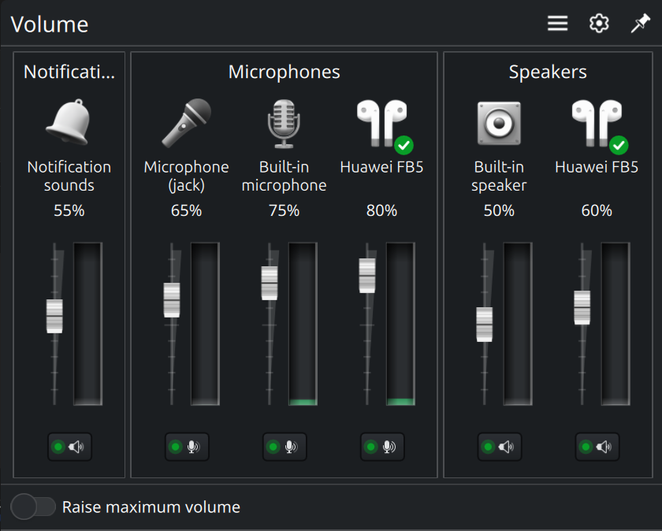
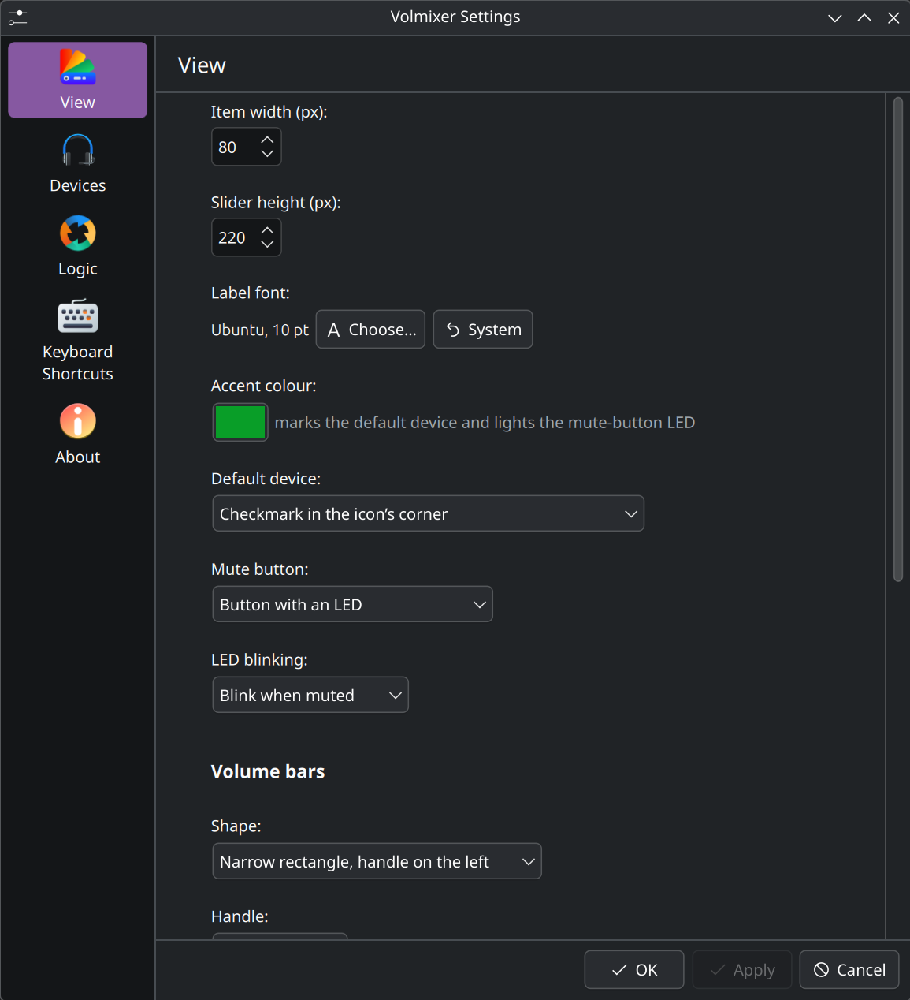
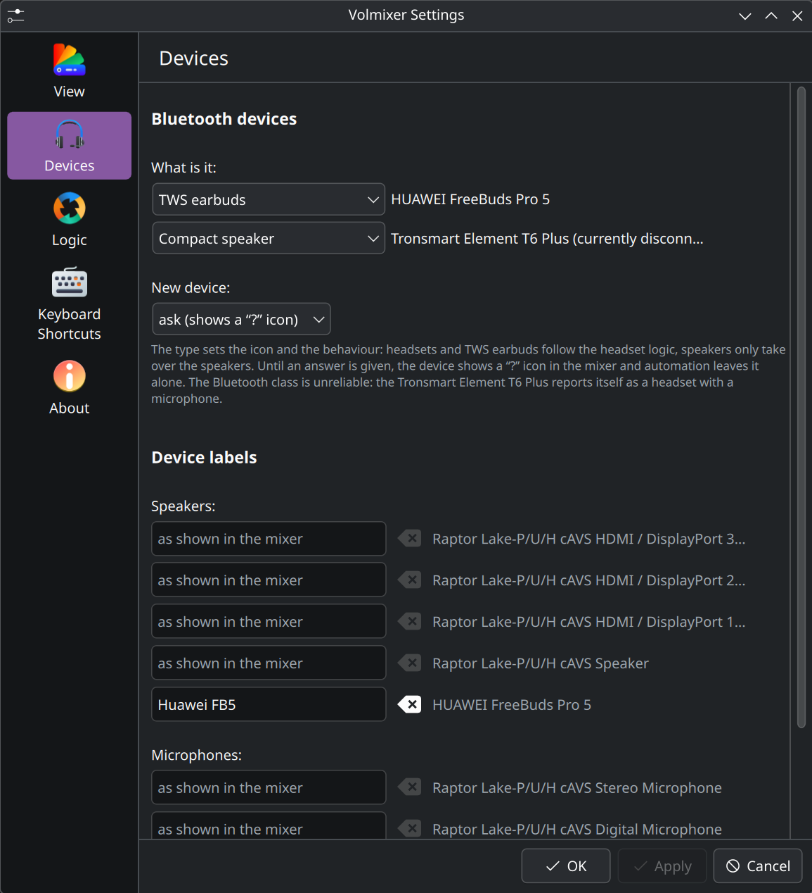
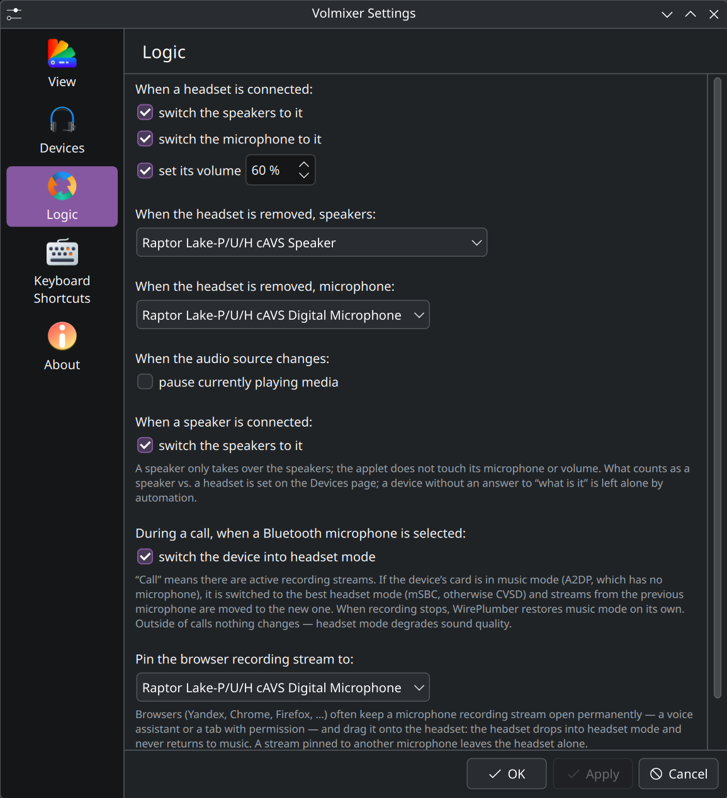

A fork of the stock Plasma 6 volume applet (`plasma-pa` 6.6.5, the `applet/` directory). All mechanics come from upstream — device and stream models, context menu, OSD, global shortcuts, drag-and-drop — only the look is changed: instead of the "Devices / Applications" tabs there are up to five groups in a row with vertical sliders in the Windows 7 style.

Tested on Kubuntu 26.04, Plasma 6.6.6, PipeWire 1.6, ASUS UX3404VA laptop.

- [Mixer layout](#mixer-layout)
- [Device icons and the default marker](#device-icons-and-the-default-marker)
- [Volume bar](#volume-bar)
- [Mute button](#mute-button)
- [Panel icon](#panel-icon)
- [Controls](#controls)
- [Settings — View](#settings--view)
- [Settings — Devices](#settings--devices)
- [Settings — Logic](#settings--logic)
- [Localization](#localization)
- [Install](#install)
- [Audio patches add-on](#audio-patches-add-on)
- [Files](#files)

## Mixer layout

Up to five groups, right to left: Recording, Applications, Notifications, Microphones, Speakers. Empty groups are hidden. Each item is laid out top to bottom: icon, two-line label, percentage, vertical volume bar, mute button at the bottom. Devices get a "default device" marker to the left of the icon when there is more than one device.

| Group | What's in it |
|---|---|
| Recording | applications recording from the microphone (source-output) |
| Applications | applications playing audio (sink-input) |
| Notifications | the system event-sound role (volume and mute for notification sounds) |
| Microphones | input devices |
| Speakers | output devices |

## Device icons and the default marker

Device icons come from the Icons8 "3D Fluency" set (free with attribution), re-tinted to silver without any colour cast. The connection type picks the icon: built-in speaker, jack headphones, USB headset, Bluetooth earbuds / headset / compact speaker / speaker-with-subwoofer, hand-held jack microphone, built-in digital microphone, HDMI/DisplayPort output. A Bluetooth device without an answer to "what is it" shows a rune icon with a "?" badge; clicking the badge opens a type picker.

The accent colour from the settings (dark green `#1e7b3c` by default) marks the default device and lights the mute-button LED. Four placements for the marker:

- **Radio button above the icon** (default) — the Windows 7 style.
- **Checkmark in the icon's corner** — a small coloured badge over the icon.
- **Icon halo** — an accent-coloured ring behind the icon.
- **Radio button in the bottom row** — next to the mute button.

The marker is shown even for a single device in a group (the stock applet hides it in that case).

## Volume bar

The fill tracks the volume, a lighter band tracks the current signal level, anything above 100 % uses the warning colour. The handle lives in `contents/images/vertical-volume-slider.svg`.

- **Shape:** wedge (narrow at the bottom, wide at the top — the original Win7 look), narrow rectangle with the handle in the middle, or narrow rectangle with the handle on the left along a notched rail.
- **Fill:** plain, glass (a subtle gloss along the rail), or an LED meter (segmented bar with transparent slits every 10 px).
- **Volume zones:** colour-by-level toggle — green up to 50 %, yellow up to 80 %, red above. Combines with any fill.
- **Zone follows signal:** fill height tracks the signal level, zone colour follows its strength. With no stream the bar is empty; volume is shown by the handle alone.
- **Signal scale:** linear (peak as-is, speech sits around 25 %) or decibels (60 dB range, speech sits around 80 %).
- **Custom colours and opacity:** fill colour, peak colour and dim colour, each with its own opacity in percent. Switch off to use theme colours.
- **Handle orientation:** horizontal (the original) or vertical — the same SVG rotated 90°.

## Mute button

- **Theme icon** — the usual `audio-volume-muted` from the theme (the legacy look).
- **Volumetric icon** — matches the device icons: silver with the accent on the sound waves; when muted, dim with a red slash.
- **LED button** — dark square with an LED. Accent-coloured when sound is on, red when muted.

**LED blink modes** (for the LED style):

- **Off** — stays lit.
- **While muted** — red blinks every half-second while the stream is muted.
- **Pulse with the signal** — brightness tracks the signal level (×3 so a quiet sound is still visible), dim in silence.

The old "muted" cross overlay on top of the icon was removed — the mute button at the bottom already shows the state.

## Panel icon

The icon in the panel, its tooltip and the scroll wheel over it follow the default sink (the one with the mixer checkmark). Scrolling raises or lowers the default sink's volume with the step from "System Settings → Sound", the 150 % ceiling when "Raise maximum volume" is on, and the usual OSD and confirmation sound. Middle click mutes everything.

## Controls

| Action | How |
|---|---|
| Volume | the slider, scroll wheel over it, ↑/↓ keys, digits 0–9 = 0–90 % |
| Mute | the button at the bottom, middle click on an item, M key |
| Default device | the "default device" radio button, click the device icon, Enter |
| Menu (ports, Bluetooth profiles, moving streams) | right click on an item, click an application icon, Menu key |
| Move an application to another device | drag the application icon onto a device |
| Panel icon | scroll — volume, middle click — mute everything |

## Settings — View



- **Item width (px)** — width of a single mixer item.
- **Slider height (px)** — height of the volume bar.
- **Label font** — custom family and size, or the system font (empty family / size 0).
- **Accent colour** — marks the default device and lights the mute-button LED.
- **Default device** — placement for the marker: radio above the icon, checkmark in the corner, icon halo, radio in the bottom row.
- **Mute button** — theme icon, volumetric icon, or LED button.
- **LED blinking** — off, blink while muted, pulse with the signal.
- **Shape** — wedge, narrow rectangle (handle in the middle), narrow rectangle (handle on the left).
- **Handle** — horizontal or vertical.
- **Fill** — plain, glass, LED meter.
- **Signal-level scale** — linear or decibels (60 dB range).
- **Volume zones** — colour volume bars by level.
- **Zone follows signal** — fill tracks signal, colour follows its strength.
- **Custom colours** — fill / peak / dim with per-colour opacity.

## Settings — Devices



- **Bluetooth devices** — a row per card seen so far, with a type picker: Headset / headphones, TWS earbuds, Compact speaker, Speaker with subwoofer. Disconnected devices are kept in the list under their last-known name.
- **New device policy** — what to do with a Bluetooth device before the user answers: show a "?" and ask, guess from the Bluetooth class, or treat as a headset.
- **Device labels** — custom labels per device (rows for Speakers and Microphones), used in place of the automatic label; the tooltip still shows the full device name.
- **Show virtual devices** — include virtual sinks/sources in the mixer.

## Settings — Logic



The applet reacts to device appear/disappear events in PipeWire — no polling.

- **When a headset is connected:** switch the speakers to it, switch the microphone to it, set its volume (percent is configurable).
- **When the headset is removed:** fall back to the chosen speakers / microphone, or built-in automatically.
- **When the audio source changes:** pause currently playing MPRIS players (browsers, Elisa, …). Works both when the headset disconnects (sound would move back to the speakers) and when it connects and takes over.
- **When a speaker is connected:** take over the speakers only — the applet does not touch the speaker's microphone or volume. "What counts as a speaker vs. a headset" is set on the Devices page.
- **During a call, when a Bluetooth microphone is selected:** switch the device's card to the best headset profile by PipeWire priority (LC3 > mSBC > CVSD) and move streams from the previous microphone to the new one. Only kicks in when there are active recording streams; WirePlumber returns the card to A2DP by itself when recording ends.
- **Pin the browser recording stream to:** move Yandex / Chrome / Firefox recording streams to the chosen microphone, so the browser does not drag the headset into HFP.

## Localization

Follows the Plasma language (System Settings → Region & Language) through KF6's `i18n` and the `TranslationDomain` set in `metadata.json`. Languages: English (built in), Russian, German, French, Spanish.

Translations live in [package/translate/translations.py](package/translate/translations.py), the single source of truth: one entry per string with a stable kebab-case key and the text in every language.

- In the code every string is `i18nc("<key>", "<English text>")`. The key is the gettext context, English is the msgid. KF6 treats English as the source language and never opens a catalog for it, so English has to be in the code.
- `package/translate/sync_sources.py` rewrites those calls from `translations.py`. Run it after changing an English string.
- `package/translate/build.py` writes `ru/de/fr/es.po` and compiles them into `contents/locale/` with the bundled pure-Python `msgfmt.py`, so the `gettext` package is not needed. It refuses to build while the code and `translations.py` disagree. `./install` runs it.

## Install

```sh
sh ./install     # install or update in ~/.local/share/plasma/plasmoids (no root)
sh ./reinstall   # same, plus restart plasmashell
sh ./run         # preview without installing; needs the plasma-sdk package (plasmoidviewer)
```

After the first install, restart plasmashell: `systemctl --user restart plasma-plasmashell`, then add the widget to a panel (right click panel → "Add Widgets…" → Volmixer) and drag it next to the system tray. Hide the stock Volume applet in the tray settings, otherwise you will see two icons.

The applet does not embed into the system tray on purpose: the tray hosts expanded applets in a fixed-width container, and the mixer window could not grow when devices appear. As a standalone widget it opens its own popup that grows to the left of the icon, with the groups pinned to the right edge.

## Audio patches add-on

Optional rebuild of the PipeWire `libspa-bluez5.so` plugin with three patches for the HFP microphone (bluez/bluez#2562, pipewire#5506 — the AT+BCC race on HUAWEI FreeBuds, FreeClip and similar). The applet itself does not fix this: HFP is engaged at the PipeWire layer. See [addons/README.md](addons/README.md) and run `sh addons/install.sh` if the HFP microphone on your Bluetooth headset does not come up.

## Files

| Path | Purpose |
|---|---|
| `package/metadata.json` | applet description, Id `org.kde.plasma.volmixer` |
| `package/contents/ui/main.qml` | stock `main.qml` with `fullRepresentation` replaced |
| `package/contents/ui/MixerGroup.qml` | group: frame, title, horizontal list |
| `package/contents/ui/MixerItem.qml` | item: `ListItemBase` + `DeviceListItem` + `StreamListItem` mechanics in a vertical layout |
| `package/contents/ui/VerticalVolumeSlider.qml` | stock `VolumeSlider` rotated vertically, wedge drawn on a Canvas |
| `package/contents/ui/ConfigGeneral.qml` · `ConfigDevices.qml` · `ConfigLogic.qml` | settings pages |
| `package/contents/code/DeviceLabels.js` | short device labels by connection type |
| `package/contents/images/icons8/` | device icons: `<kind>.png` in silver (Icons8 3D Fluency) |
| `package/contents/images/vertical-volume-slider.svg` | the slider handle |
| `package/translate/` | `translations.py` (single source), `sync_sources.py`, `build.py`, pure-Python `msgfmt.py`, generated `ru/de/fr/es.po` |
| `brand/` | AiKDE logo (`logo.svg`, `logo-lockup.svg`), README header `header.svg` and the widget icon `volmixer-icon.svg` |
| `addons/` | optional PipeWire patches for a Bluetooth-headset microphone in HFP mode (see `addons/README.md`) |
| `docs/screenshots/` | screenshots used in this README |
